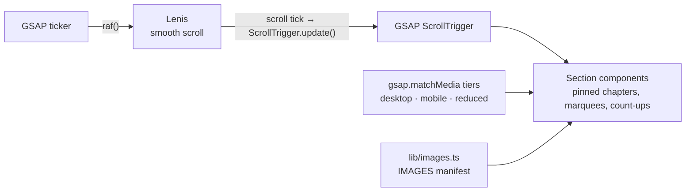

# ORA — Residence Above the Sea

**A cinematic, scroll-driven single-page marketing site for a fictional Tel Aviv residence tower, built as an interaction-system study: pinned scroll chapters, scrubbed parallax, marquees, count-ups and a custom cursor.**

**Live:** https://delevski.github.io/ORA-Test-Build-UI/


## What it does

ORA is a full-screen, story-like landing page. There is no real property or developer behind it: the goal was to reverse-engineer the *techniques* of a high-end reference site, not its brand, copy or imagery ([`REFERENCE_ANALYSIS.md`](REFERENCE_ANALYSIS.md) has the breakdown).

Sections, in scroll order:

- **Preloader** with a counter that gates the hero
- **Hero** with a fullscreen entrance and a scrubbed exit
- **Cinematic chapters**: a reusable pinned section with 5 visual variants and SVG foregrounds
- **Stats** with count-ups
- **Why ORA**: editorial block with mouse-reactive imagery
- **Residence gallery**: hover/scroll-driven room switcher plus a horizontal strip
- **Building marquee** (dual row, speeds up with scroll velocity) and a text ribbon
- **A day above the city**: pinned timeline of scenes
- **Amenities**, **final CTA** with a price count-up, footer
- **Custom cursor** (fine pointers only), **magnetic** buttons, a nav that flips theme on scroll with a progress bar
- **Ambient sound**: a recorded sea-lobby loop with a sound toggle

All figures on the page (size, floors, price) are placeholder copy for a fictional listing.

## Architecture



Key design decisions:

- **One scroll clock.** Lenis owns the scroll physics, GSAP's ticker drives Lenis's `raf` loop, and every Lenis tick updates ScrollTrigger, so smooth scroll and scrubbed animation never drift apart.
- **Three motion tiers per component.** Every animated component registers `desktop` (full scrub and parallax), `mobile` (lighter, shorter motion) and `reduced` branches through `gsap.matchMedia()`. With `prefers-reduced-motion`, Lenis is not created at all and content is set straight to its final visible state, never left half-animated.
- **CSS-sticky pinning.** Each chapter is a tall wrapper `section` with a `position: sticky` full-height viewport inside; a scrubbed ScrollTrigger animates only `transform`, `opacity` and `clip-path` (no layout-triggering properties), and `will-change` is applied only to elements that move.
- **Images as data.** Every image and its alt text goes through one `IMAGES` manifest in `lib/images.ts`; no component hardcodes a path, so the whole photo set can be replaced without touching components ([`IMAGE_REQUIREMENTS.md`](IMAGE_REQUIREMENTS.md) lists each slot's aspect ratio and mood).
- **Static export for GitHub Pages.** With `GITHUB_PAGES=true` (set by the deploy workflow) Next.js builds a fully static export with the right `basePath`, exposed as `NEXT_PUBLIC_BASE_PATH` for raw `<video>` and `<a>` tags.

## Tech stack

- **Next.js 16** (App Router, Turbopack) + **React 19** + **TypeScript**
- **Tailwind CSS 4** (design tokens in `app/globals.css`)
- **GSAP 3** (ScrollTrigger, `@gsap/react` `useGSAP`) for all motion
- **Lenis** smooth scrolling
- `next/image` for optimized, lazy-loaded images
- **GitHub Actions → GitHub Pages** deploy (`.github/workflows/deploy.yml`)

## Project structure

```
app/            layout (fonts, metadata, smooth-scroll provider), page, global styles
components/     one folder per section: preloader, navigation, hero, cinematic-scene,
                stats, why-section, residence-gallery, building-marquee, ribbon-marquee,
                day-timeline, amenities, final-cta, footer, custom-cursor, sound-toggle,
                providers (Lenis + GSAP), ui (Magnetic)
lib/            gsap.ts (plugins + matchMedia tiers), images.ts (image manifest)
hooks/          useIsFinePointer
public/         images, splash video, ambience audio
```

## Run locally

```bash
npm install
npm run dev        # http://localhost:3000
npm run build && npm run start
```

## Status

Complete as a study and deployed to GitHub Pages from `main`.

## Author

**Or Delevski** · https://ordelwebsite.vercel.app
